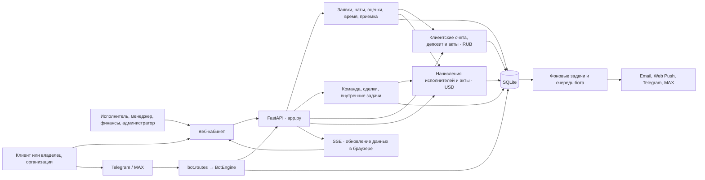
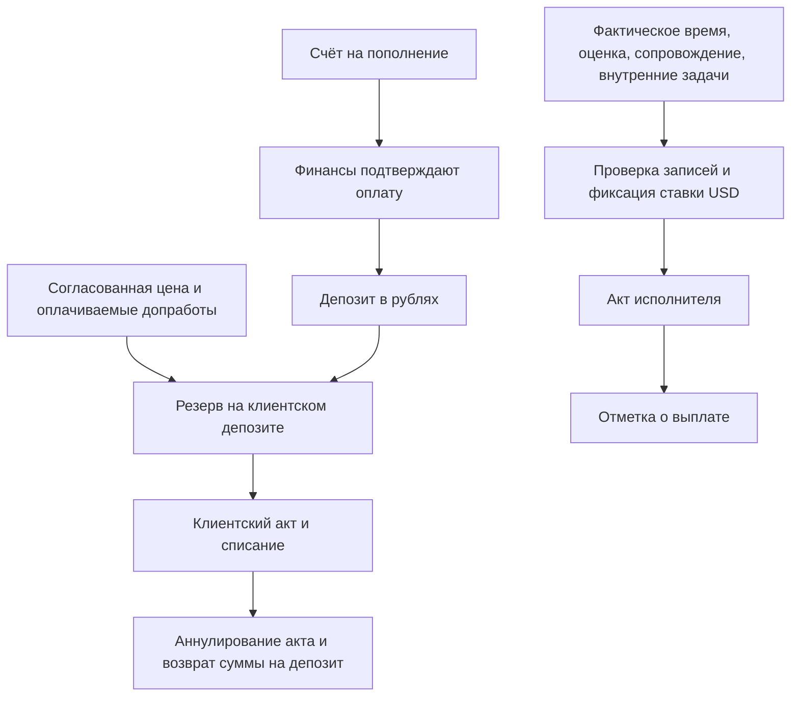

# Карта логики Service Desk

Срез рабочего дерева от 9 ноября 2026 года. Карта описывает реализованные сценарии по текущему коду и графу `billing_system`. Порядок работы по ролям описан в [регламенте](INSTRUCTIONS.md), ранние продуктовые решения — в [черновике ТЗ](../PRODUCT_SPEC.md). Очередь изменений ведётся в [таскбуке](TASKBOOK.md).

## Контуры и связи

| Контур | Вход и опорный код | Что хранится или меняется |
| --- | --- | --- |
| Веб и доступ | `GET /` и `/landing`, [app.py](../app.py), [web/main.js](../web/main.js). `current_user`, `ticket_for`, `customer_can_decide`, `require_finance` | Cookie `desk_session`, хеш сессии в `sessions`, активность пользователя, членство и область доступа. UI запрашивает данные у API. |
| Заявки | `/api/tickets`, `add_ticket_service`, `create_estimate`, `pm_review_estimate`, `decide_estimate_service`, `change_status`, `accept_work_service` в [app.py](../app.py) | `tickets`, `ticket_events`, `estimates`, сообщения, вложения, внутренние заметки и `ticket_participants`. |
| Коммуникации | `/api/chats`, `ticket_from_chat`, [company_chat.py](../company_chat.py), [bot/](../bot), [mailer.py](../mailer.py), [web_push.py](../web_push.py) | Общий диалог компании, связанная заявка, привязки бота, очереди доставки и прочитанность. Чат и заявка имеют собственные ветки переписки. |
| Операции и продажи | `/api/team`, [team_management.py](../team_management.py); `/api/tasks`, [task_tracker.py](../task_tracker.py), [web/tasks.js](../web/tasks.js) | Функции сотрудников и права, команды клиентов, сделки, задачи, встречи, участники и история. Передача сделки создаёт связанную задачу; задачи используют общие правила `save_work`. |
| Клиентские финансы | `/api/billing`, `get_billing_overview`, `create_invoice_document`, `update_invoice_status` в [app.py](../app.py), [billing_ledger.py](../billing_ledger.py) | Депозит, резервы, начисления и корректировки в рублях, снимки счетов и актов. Выборки ограничены клиентом или организацией, клиентская проекция убирает внутренние ставки и часы. |
| Выплаты исполнителям | `/api/payroll`, [payroll.py](../payroll.py), [web/payroll.js](../web/payroll.js) | Работа по заявкам и внутренним задачам, время оценки и сопровождение. История ставок, решения по записям, снимки состава актов и отметки выплат. |
| SLA и рабочий ритм | `/api/analytics`, `/api/decisions`, `calculate_analytics`, [productivity.py](../productivity.py) | Аналитика и CSV. Время сдачи восстанавливается из `ticket_events` по текущему циклу работы. Отдельно работают очередь решений, эскалации, напоминания, регулярные заявки, недельный журнал времени и объединение дублей. |
| Администрирование | `/api/admin`, [admin.py](../admin.py), [web/admin-ui.js](../web/admin-ui.js) | Управление пользователями и организациями, расширенное редактирование заявок, административный журнал. |

## Путь заявки

1. **Обращение.** Клиент создаёт заявку в вебе или боте. Команда может оформить её от имени клиента. Заявка также создаётся из чата или по расписанию. `ticket_for` ограничивает видимость и запись по роли, назначению и участию. В общей заявке решение принимает владелец организации, в личной — автор.
2. **Оценка.** Исполнитель вводит плановое время и отдельно фиксирует время, затраченное на оценку. Менеджер готовит клиентское предложение с ценой в рублях. Клиент принимает, отклоняет или запрашивает пересмотр. В пределах настроенного денежного лимита система может согласовать оценку автоматически.
3. **Работа.** Исполнитель ведёт фактическое время. Дополнительный объём проходит отдельное согласование у менеджера и, если он оплачивается клиентом, у клиента. Учёт фактического времени служит источником для внутреннего расчёта. Клиентская стоимость следует согласованной сумме.
4. **Результат.** Штатный переход в `done` требует согласованной оценки, фактического времени и завершённых решений по дополнительным часам. Клиент принимает результат (`closed`) или возвращает на доработку (`working`). Менеджер может закрыть заявку и позднее открыть её через отдельную операцию с причиной. Включение в акт блокирует это переоткрытие до корректировки акта. Отказ клиента от заявки, созданной командой, и объединение дубля тоже могут закрыть заявку. История различает их через события `decline` и `merged`.
5. **Документы.** Финансы формируют акт по подходящим работам в `done` или `closed` и оплачиваемым записям сопровождения. Отдельный внутренний акт исполнителя собирается из подтверждённых источников времени.

## Два финансовых потока

- **Депозит.** `billing_transactions` фиксирует движение денег. `billing_ledger.sync_reservations` пересчитывает резерв согласованных сумм на записи клиента при изменениях в SQLite. При создании акта резерв заменяется списанием, а при его отмене система возвращает сумму на депозит и вновь учитывает согласованные работы в резерве. Оплата счёта повторно не зачисляет депозит.
- **Выплаты.** `payroll_sources` связывает записи с решениями и актами, ставки хранятся в центах USD за час. Подтверждение использует предварительный расчёт, акт фиксирует состав, повторяемый ключ создания и ограничение уникальности защищают от повторного включения записи.
- **Граница.** Внутренняя задача может начислять выплату исполнителю. Клиентский акт использует согласованные заявки и оплачиваемое сопровождение. Публичные итоги встречи хранятся как неоплачиваемая запись сопровождения.

## Правила доступа и исполнение

- Базовые роли — `customer`, `employee`, `admin`. Менеджерское право, финансовые полномочия, права на задачи и область видимости задают отдельные правила. В компании клиента различаются `owner`, `member`, `viewer`. Клиентские представления заявки и финансов проходят через `customer_record` и `customer_finance_projection` соответственно.
- [app.py](../app.py) открывает транзакции через `db()` с foreign keys и инициализирует SQLite в режиме WAL. Запись, аудит и финансовые корректировки используют общую БД. Критичные операции сериализуются через `BEGIN IMMEDIATE`.
- `app.run_background_tick` ведёт почтовую очередь, напоминания, сводки, IMAP и плановые операции `productivity`. `BotEngine` проверяет контекст и обрабатывает входящие события Telegram/MAX через общие сервисы заявок, решений и чатов. `bot.worker` берёт исходящие сообщения из SQLite-очереди с временной блокировкой и перед отправкой перепроверяет доступ получателя.
- `RealtimeBus` и `/api/events` сигнализируют браузеру о смене данных. Содержимое повторно загружается через HTTP с текущими правами. Для вложений, почты, push и базы локальный запуск использует настройки из [.env.example](../.env.example).
- `dispatch_webhooks` пишет исходящие события в `webhook_outbox` вместе с бизнес-операцией. Фоновая задача [webhook_delivery.py](../webhook_delivery.py) отправляет их по проверенному адресу, повторяет временные сбои и сохраняет журнал попыток. Получатель может дедуплицировать повторы по `X-Desk-Delivery-ID`.

## Где смотреть при изменениях

| Сценарий | Начальная проверка |
| --- | --- |
| Смена статуса и приёмка | [test_bulk_and_working.py](../tests/test_bulk_and_working.py), [test_bil04_ticket_controls.py](../tests/test_bil04_ticket_controls.py), [test_flows.py](../tests/test_flows.py) |
| Клиентские деньги и видимость | [test_billing_finance_journey.py](../tests/test_billing_finance_journey.py), [test_pm_billing.py](../tests/test_pm_billing.py), [test_customer_finance_projection.py](../tests/test_customer_finance_projection.py) |
| Выплаты и внутренние задачи | [test_payroll.py](../tests/test_payroll.py), [test_payroll_batch.py](../tests/test_payroll_batch.py), [test_task_time.py](../tests/test_task_time.py) |
| Команда, боты и SLA | [test_team_management.py](../tests/test_team_management.py), [test_bots.py](../tests/test_bots.py), [test_productivity.py](../tests/test_productivity.py), [test_analytics_sla_history.py](../tests/test_analytics_sla_history.py) |
